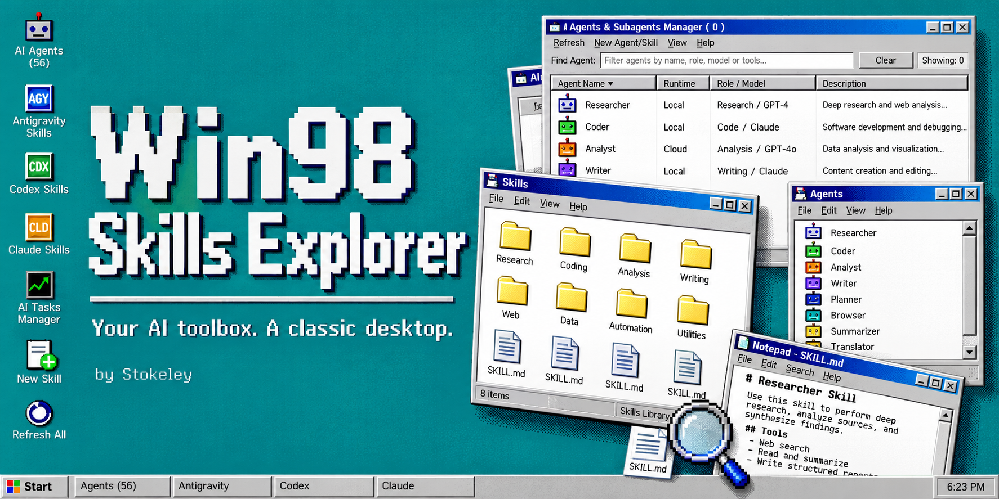
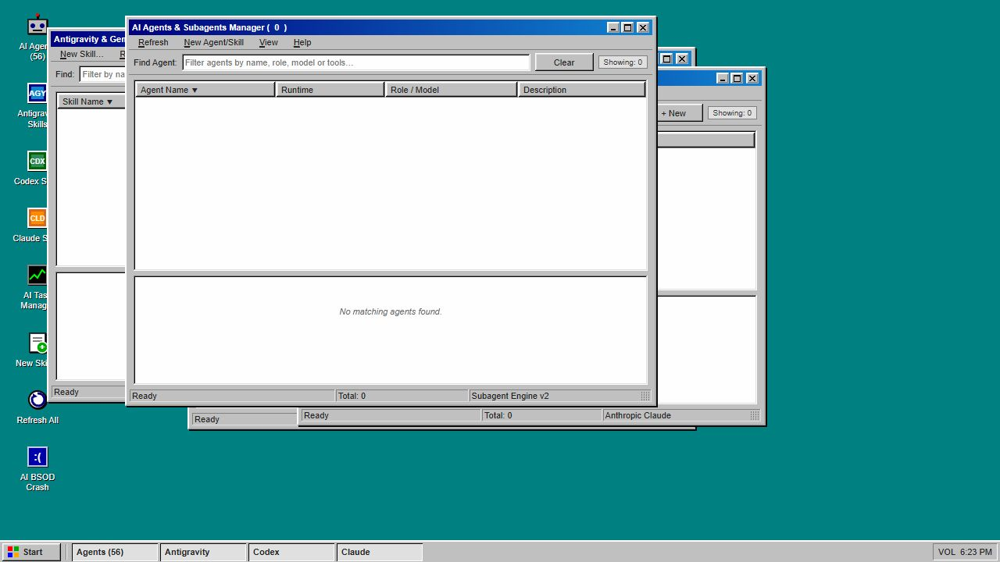

<p align="center"></p>

<h1 align="center">Win98 Skills Explorer</h1>
<p align="center"><b>Your AI toolbox. A classic desktop.</b><br />A Windows 98-inspired local workspace for browsing AI skills and agent metadata.<br /><sub>Designed &amp; developed by <a href="https://github.com/StokeleyDev">Stokeley</a></sub></p>

---

## A familiar desktop for a new kind of toolbox

Browse your **Antigravity / Gemini**, **Codex**, and **Claude Code** skill libraries through classic Explorer windows. Search descriptions, inspect skill files in a Notepad-style editor, and organize your local collection without leaving the retro desktop.

Gray beveled controls, blue title bars, pixel fonts, a Start menu, movable windows, and a simulated task manager bring the late-90s desktop feel to a small Python and vanilla JavaScript app.

## Inside the desktop

| Window | What it does |
| :--- | :--- |
| Skills explorers | Search and inspect skill names, descriptions, sources, and paths |
| Notepad | Read and edit `SKILL.md` files in configured writable skill folders |
| New Skill | Create a starter skill in a selected runtime's skill directory |
| Agents manager | Browse built-in example agent entries and discovered agent/plugin metadata |
| Refresh | Rescan local skill libraries and update the catalog |
| Desktop extras | Start menu, taskbar, window controls, and playful retro dialogs |

The task manager and built-in agent status labels are **interface simulations**, not live monitoring or agent execution. This app manages files and metadata; it does not launch the listed AI agents.

## Quick start

Requires **Python 3.10 or newer**. No pip packages, npm install, or build step needed.

```bash
git clone https://github.com/StokeleyDev/win98-skills-explorer.git
cd win98-skills-explorer
python server.py
```

Open **http://localhost:1998**. On Windows, you can also double-click **`launch.bat`**.

On first load, the server scans your local skill folders. Use **Refresh All** after adding or changing skills elsewhere. You can run `python scan_skills.py` separately to regenerate the catalog.

## Your folders, your setup

Defaults use the current user's home directory. Set environment variables before starting the app to use a different setup:

| Variable | Default |
| :--- | :--- |
| `WORKSPACE_SKILLS_DIR` | `.agents/skills` in the parent of the launch directory |
| `CODEX_HOME` | `~/.codex` |
| `CLAUDE_CONFIG_DIR` | `~/.claude` |
| `GEMINI_HOME` | `~/.gemini` |

For example, in PowerShell:

```powershell
$env:WORKSPACE_SKILLS_DIR = 'C:\my-project\.agents\skills'
python server.py
```

New skills are created in the workspace skills directory, `CODEX_HOME/skills`, or `CLAUDE_CONFIG_DIR/skills`. File operations are restricted to `SKILL.md` files in these writable directories. Catalog entries from other scanned locations can be listed, but are not editable through the API.

Keep the server local: it binds to **127.0.0.1**. Saving edits changes your real files; deleting a skill removes its entire folder. Back up skills you want to keep. Opening a file's folder in Explorer is Windows-specific.

`skills_data.json` and `skills_data.js` are generated on your computer and excluded from Git. Your installed skill inventory is not bundled with this repository.

## Actual interface



The image above is an actual application screenshot with an empty catalog. The cover is an AI-generated illustration inspired by the application.

## Built with

**Python standard library · HTML · CSS · Vanilla JavaScript**

- `server.py` — loopback HTTP server and local file API.
- `scan_skills.py` — scans skill frontmatter and agent metadata.
- `index.html` — desktop shell and client-side interactions.
- `98.css` and `fonts/` — retro styling and bundled bitmap-style fonts.

Font attribution and original license notices are retained in `fonts/src/`: **MS Sans Serif** and **MS Sans Serif Bold** by **lou**, distributed under **CC BY-SA 3.0**. This is an independent project, not affiliated with Microsoft, OpenAI, Anthropic, or Google.
